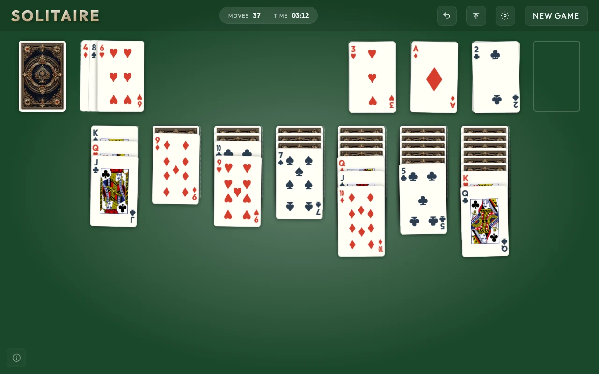
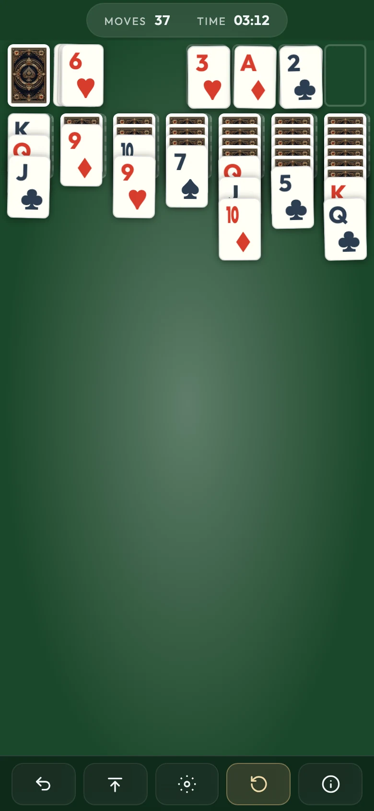

# Klondike Solitaire

Classic Klondike Solitaire for the browser, written in plain HTML, CSS and
JavaScript. There is no framework, no dependency at runtime and no build
step. It plays with a mouse, by touch or entirely from the keyboard, scales
from a 320px phone to a 1920px desktop, and installs as an offline PWA.

<p align="center">
  
  &nbsp;
  
</p>

## Features

- Draw 1 or draw 3, with the last three waste cards fanned
- Drag and drop with the mouse or by touch, using a single Pointer Events code path
- Double-click or double-tap to send a card to its best spot
- Autocollect: one button sends every playable card to the foundations
- Undo, with a 5-move penalty, plus a move counter and a timer
- Full keyboard play: arrow keys, Enter or Space to pick up and drop, Esc, Z to undo
- Screen-reader support: a live region announces each move, dialogs keep focus
  inside them, and text colours are checked against WCAG AA contrast
- Respects `prefers-reduced-motion`, and follows it if it changes mid-game
- Works offline after the first visit, and can be installed as an app
- Choice of table colour, saved in `localStorage`
- Fonts, images and sounds are all served from the repo; the page makes no
  third-party requests

## How it's built

A few parts took some care; [docs/ARCHITECTURE.md](docs/ARCHITECTURE.md)
has the full picture.

- Mouse, pen and touch all go through one Pointer Events pipeline. A dragged
  card stays in its own pile's DOM and moves only by CSS custom properties. It
  also gets `pointer-events: none`, so `document.elementsFromPoint()` can see
  the pile under it at drop time. Snapping back is the same CSS transition
  running back to zero; no clone element is involved.
- Pointer, keyboard, double-click and autocollect share the same
  `canPickUp` / `isValidMoveFor` / `executeMove` functions, so no input path
  can make a move that another would refuse.
- Renderers rebuild piles from state with a keyed diff. A card that didn't
  change keeps its DOM node, so focus and running transitions survive a
  re-render.
- Every deferred animation callback checks a deal counter before it touches
  the board, which is why New Game in the middle of an animation is safe.
- The service worker matches versioned asset URLs exactly, so a deploy can't
  pair new HTML with an old cached script. It falls back to the unversioned
  precache only when offline.
- Start-up stays light: the page creates no `AudioContext` and no full-screen
  canvas until it needs them, and the self-hosted font subsets come to 53 KB.

## Run it

Open `index.html` in a browser; it works straight from the file system.

To try the service worker and offline mode, serve the folder over HTTP:

```bash
npm run serve        # python3 -m http.server 8123
```

The page deliberately skips the service worker on `localhost` and `file://`,
so a stale worker can't get in the way during development. To test offline
behaviour locally, open `http://sw.localhost:8123/` instead: browsers treat
`*.localhost` as a secure origin, and the page doesn't treat it as localhost.

## Tests

```bash
npm install
npx playwright install chromium
npm test             # all 10 viewports
npm run test:quick   # 1280px only
```

There are 119 [Playwright](https://playwright.dev) tests, each run at 10
viewport widths from 320 to 1920px: 1,190 runs in all. They cover move
validation, undo, draw-3, the drag pipeline and its race conditions, keyboard
play, focus handling in the dialogs, reduced motion, settings parsing, the
service worker's caching rules, font loading and the mobile layout. Tests
build exact boards instead of relying on random deals, and check structure
rather than comparing screenshots. GitHub Actions runs each viewport as a
separate job.

## Project layout

```
index.html          Markup, PWA wiring, service-worker registration
manifest.json       Web app manifest
sw.js               Service worker (offline cache)
css/
  fonts.css         @font-face for the self-hosted fonts
  styles.css        Layout, header and toolbar, dialogs, responsive rules
  cards.css         Card faces and backs, drag states, animations
js/
  game.js           State, rules, rendering, input, animation, audio, settings
  cards.js          Builds a card's DOM (pips, court-card art)
  confetti.js       Canvas confetti for the win
  motion.js         Reduced-motion and device capability flags
court-cards/        Court-card SVGs and card back, with their licences
fonts/              Self-hosted WOFF2 subsets and the OFL
sounds/             Two CC0 sound effects
icons/              App icons, and the script that renders the PNGs
tests/              Playwright specs
docs/               Architecture notes and screenshots
```

## Deploying

Any static host works, including GitHub Pages. Every path is relative, so the
app runs unchanged from a domain root or a subfolder such as
`https://<user>.github.io/<repo>/`.

When you change a file, bump its version comment and the matching `?v` in
`index.html`. That's enough for CSS and JS. Bump `CACHE_VERSION` in `sw.js`
when an unversioned asset changes (fonts, images, sounds), or when the
precache list changes.

## Licensing

- Code: [MIT](LICENSE), © 2026 Guillelmus.
- Court-card art: modified from *Vectorized Playing Cards* by Chris Aguilar,
  LGPL 3.0. See [court-cards/CREDITS.md](court-cards/CREDITS.md).
- Card back: AI-generated and released as CC0, also covered in
  [court-cards/CREDITS.md](court-cards/CREDITS.md).
- Fonts: Outfit, Lora and Noto Sans Symbols 2, all under the SIL Open Font
  License. See [fonts/LICENSE.md](fonts/LICENSE.md).
- Sounds: CC0. See [sounds/licenses.md](sounds/licenses.md).
